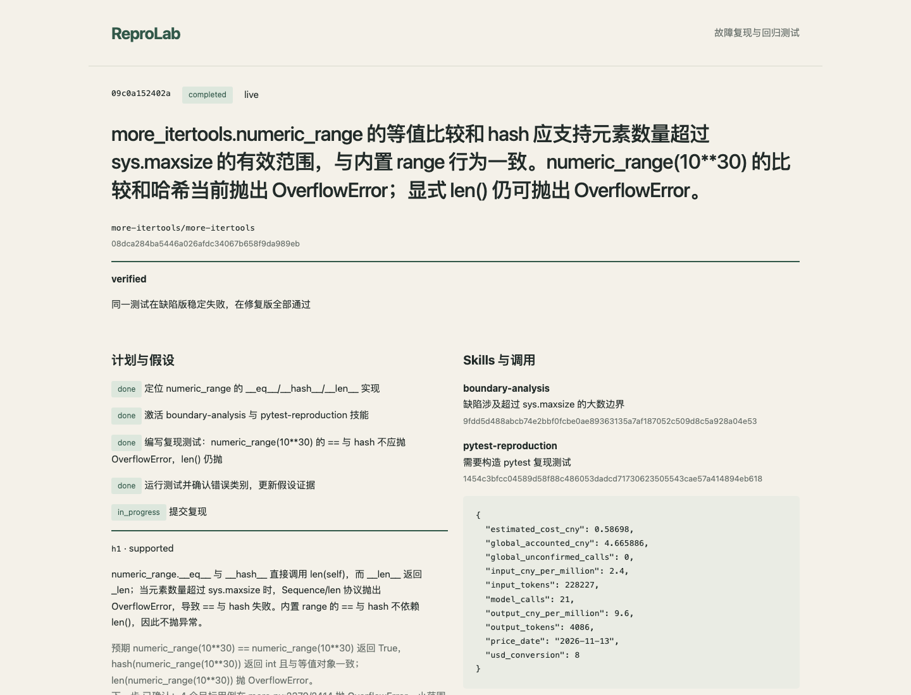
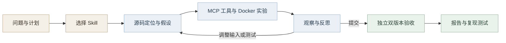

<h1 align="center">ReproLab</h1>
<p align="center"><strong>故障复现与回归测试 Agent</strong></p>
<p align="center">从缺陷描述出发，加载 Skills、调查源码并执行实验，<br>交付带执行依据的复现测试与验证报告。</p>
<p align="center"><code>mini-swe-agent</code> · <code>MCP</code> · <code>Agent Skills</code> · <code>Docker / pytest</code></p>
<p align="center"><a href="#快速开始">快速开始</a> · <a href="examples/">运行记录</a> · <a href="docs/DESIGN.md">设计与架构</a> · <a href="docs/EVALUATION.md">评测</a></p>

---

## 项目能力

| 能力 | 实现方式 |
| --- | --- |
| 规划与实验 loop | 结构化计划、假设、预期观察和执行反馈，按结果调整下一步 |
| Skills | 按需加载指令、模板与脚本，保存内容快照和实际调用记录 |
| MCP 工具 | 通过真实 stdio Client / Server 调用任务专属工具，schema 与执行层共同检查输入 |
| 上下文与记忆 | 保留任务状态、活动 Skill 与实验，裁剪历史后按 artifact ID 取回原文 |
| 隔离执行 | 非 root 容器、源码只读、运行阶段关闭网络、资源和时间限制 |
| 独立验收 | 同一测试在缺陷版重复失败、修复版重复通过，关联版本和测试哈希 |
| 可恢复任务 | SQLite 状态、工具操作 ID、费用预留与轨迹持久化 |

## 一次实际调查

`numeric_range` 的初稿包含一个非法关键字调用。独立验收阻止提交后，Agent 根据缺陷版构造函数签名修正测试，恢复原任务并完成双版本验证。原测试、修改 diff、模型动作和验收日志均保留于[运行包](examples/runs/full/numeric-range/report.json)。



八条小规模真实模型任务与八条单次生成对照均通过验证；当前题集尚未证明完整 Agent 的成功率优势。完整失败记录、消融及费用见[评测](docs/EVALUATION.md)。

## 快速开始

准备 Python 3.12、uv 和 Docker，确认 Docker 服务已经启动。

```bash
git clone https://github.com/carefreelove/ReproLab.git
cd ReproLab
uv sync --frozen
cp .env.example .env
docker build -t reprolab-python:0.1.0 -f docker/Dockerfile .
```

在 `.env` 填写 `DEEPSEEK_API_KEY`，也可使用终端已有的 `ANTHROPIC_AUTH_TOKEN`。凭据由宿主模型客户端读取，配置文件已被 Git 忽略。

```bash
uv run reprolab run --case chunked-even
uv run reprolab show <run-id>
uv run reprolab resume <run-id>
uv run reprolab serve
```

也可直接重新验收公开测试，无需模型凭据：

```bash
uv run reprolab replay examples/runs/full/chunked-even
```

浏览器打开 `http://127.0.0.1:8765`，查看计划、假设、Skill 使用、工具输入输出、测试代码及原始日志。页面为本地只读视图。

普通公开仓库可通过固定 commit 与本地问题文件启动。

```bash
uv run reprolab run --repo https://github.com/owner/project \
  --commit <full-commit-sha> --issue issue.md
```

首版执行环境支持纯 Python 项目，包含 pytest。源码从 `/workspace` 导入，额外依赖应在受控 Docker 镜像中准备。运行阶段的工具按当前任务限制路径与写入范围。

每次任务保存以下产物。

```text
.reprolab/runs/<run-id>/
├── report.md
├── report.json
├── trajectory.json
├── events.jsonl
├── tests/
├── artifacts/
└── skills/
```

`Ctrl+C` 保存任务并取消执行。`resume` 延续累计时间、调用次数、费用及 Skill 快照。通过 `REPROLAB_HOME` 指定数据目录时，使用同一绝对路径延续账本。

## Agent 如何工作



工具返回的日志、原始代码与 Issue 均作为待分析资料。模型形成的结论需要关联实际实验，最终验证读取同一份测试内容及两个固定源码版本。

### Skills

| Skill | 使用场景 |
| --- | --- |
| `pytest-reproduction` | 构造真实目标调用、fixture 与行为断言 |
| `boundary-analysis` | 零值、负值、空输入、大数、时间和精度边界 |
| `iterator-state` | 迭代器消耗、生成器推进与实例间共享状态 |
| `failure-triage` | 区分收集、导入、环境、目标异常及断言失败 |

启动时仅加载目录元数据，Agent 激活后获取正文，资源和脚本按需读取。内置目录与显式 `--skills-dir` 均支持 SKILL.md 格式，显式目录覆盖内置同名 Skill。每个任务保存独立快照，恢复沿用其原内容。

```bash
uv run reprolab skills list
uv run reprolab skills validate src/reprolab/skills
uv run reprolab run --case shared-state --skill iterator-state
```

### MCP 与工具

13 个工具覆盖计划、假设、经验查询、Skill 激活、资源与脚本、源码定位、测试编写、实验执行、资料取回和提交。实际通道包含协议协商、工具发现与调用，工具 schema 由 SDK 生成。 [接口说明](docs/TOOLS.md)

### 验证结论

- `verified` 表示测试在缺陷版重复触发问题，在修复版通过。
- `candidate` 表示缺陷版具有复现依据，尚缺修复版验证。
- `not_reproduced` 表示当前输入在缺陷版通过。
- `inconclusive` 表示环境、稳定性或测试有效性等检查需要进一步核对。

双版本差异与静态规则提供复现依据，测试语义需要结合原始缺陷描述审查。容器执行适用范围为受控的纯 Python 项目。

## 测试与评测

```bash
uv run ruff check src tests
uv run pytest -q -m 'not docker'
REPROLAB_DOCKER_TESTS=1 uv run pytest -q -m docker
uv run reprolab evaluate --suite smoke
uv run reprolab evaluate --suite smoke --live
uv run reprolab evaluate --suite smoke --live --ablations-only
```

默认评测使用脚本模型与预设测试，验证真实 MCP、Docker 和验收协议。真实历史案例首次下载源码需要联网。`--live` 使用真实 DeepSeek，并为主题集额外运行单次生成对照，会产生 API 费用。

消融分别关闭 Skills 和显式反思状态反馈，保持工具与执行环境一致。各案例使用独立经验空间。真实记录与适用条件见 [评测记录](docs/EVALUATION.md)。

## 预算与运行限制

默认每任务最多 25 次模型调用、8 次测试实验和 600 秒累计运行时间，单次测试最多 60 秒，模型单次输出最多 4096 tokens。

同一数据目录的全部调用共用人民币 20 元上限。发送前事务预留费用，返回完整 usage 后结算。未知用量持续保留完整预留，并结束该任务的付费执行。

价格快照采用 2026-11-13 Flash 高峰未命中缓存输入每百万 tokens 0.30 美元、输出 1.20 美元，以固定 8 CNY/USD 保守换算为 2.4 元与 9.6 元。账本记录模型、tokens 和预留，实际账单以服务商为准。 [官方价格](https://api-docs.deepseek.com/quick_start/pricing/)

## 来源与设计

核心循环复用 mini-swe-agent，MCP 通信使用官方 Python SDK。Skills、复现任务状态、工具适配、容器约束、独立验收与评测由本项目开发。项目由 AI 编程助手协作实现，来源与验证范围逐项记录。

- [设计依据与取舍](docs/DESIGN.md)
- [MCP、Skills 与状态接口](docs/TOOLS.md)
- [上游复用与项目开发](docs/UPSTREAM.md)
- [第三方许可声明](THIRD_PARTY_NOTICES.md)

MIT。
